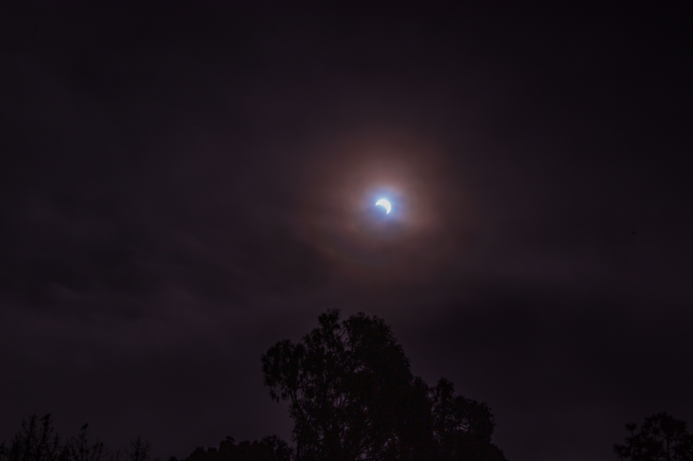
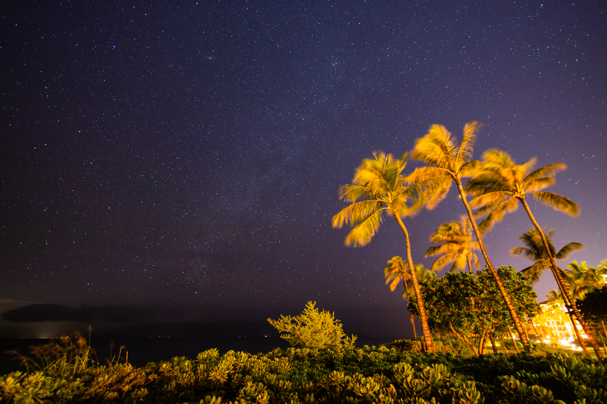
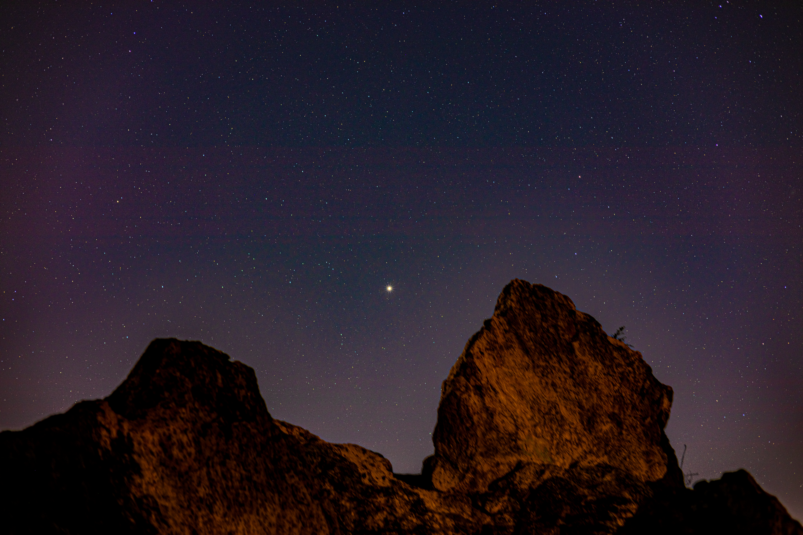

  

  

  

  <a href="{{ 'assets/img/photography/astro/inbox-2/Eclipse-4881.jpg' | relative_url }}" data-lightbox="astro" aria-label="The solar corona surrounding the dark disk of a total eclipse.">
    
  </a>

  <a href="{{ 'assets/img/photography/astro/inbox-2/Eclipse-4940.jpg' | relative_url }}" data-lightbox="astro" aria-label="A bright point of sunlight at the edge of an eclipsed Sun.">
    
  </a>

  <a href="{{ 'assets/img/photography/astro/inbox-2/Eclipse-Satellite.jpg' | relative_url }}" data-lightbox="astro" aria-label="A solar eclipse with a bright corona and a thin streak of light nearby.">
    
  </a>

  <a href="{{ 'assets/img/photography/astro/inbox-2/Eclipse-Satellite-Uncropped.jpg' | relative_url }}" data-lightbox="astro" aria-label="A wide view of a solar eclipse against a dark sky.">
    
  </a>

  <a href="{{ 'assets/img/photography/astro/inbox-2/IMG_8674.jpg' | relative_url }}" data-lightbox="astro" aria-label="A star-filled night sky with clouds above a dark landscape.">
    
  </a>

  <a href="{{ 'assets/img/photography/astro/inbox-2/stacked-Edit-1.jpg' | relative_url }}" data-lightbox="astro" aria-label="The Milky Way stretching across a star-filled sky.">
    
  </a>

