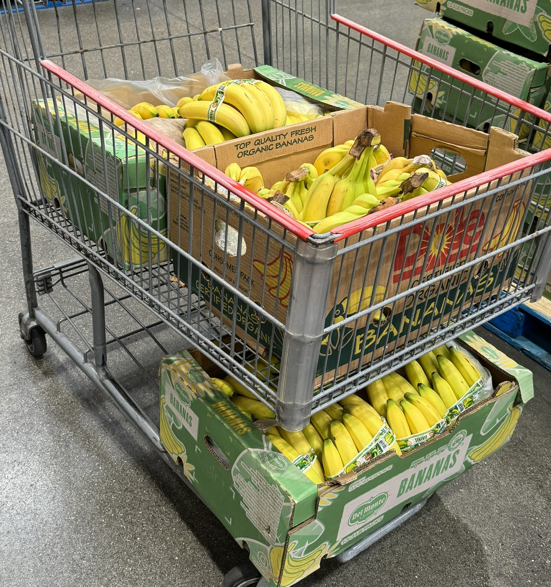

[EECS 106A (*Introduction to Robotics*)](https://ucb-ee106.github.io/eecs106a-fa23site/) is Berkeley EECS's first introductory undergraduate course teaching students robotics – kinematics, dynamics, control of robot manipulators, robotic vision, and sensing.

Alongside running sections, holding office hours, writing and proctoring exams, and mentoring and grading final projects, I worked on the lab curriculum and course logistics:
- Adapted the EECS 16B lab autograder for EECS 106A.
- Updated [Lab 1](https://ucb-ee106.github.io/eecs106a-fa23site/assets/labs/lab1.pdf), [Lab 3](https://ucb-ee106.github.io/eecs106a-fa23site/assets/labs/lab3.pdf), and [Lab 5](https://ucb-ee106.github.io/eecs106a-fa23site/assets/labs/lab5.pdf). The average duration students took to finish these labs greatly decreased, showing an improvement in lab quality
- Wrote a new [Lab 7](https://ucb-ee106.github.io/eecs106a-fa23site/assets/labs/lab7.pdf) to focus on full-stack robotics with the Sawyer, using the cameras on the Sawyer to locate positions and execute custom trajectories. This lab ended up forming the basis for many students’ final projects, showing its importance in the lab curriculum

We made our entire Midterm 1 banana-themed and then handed out bananas to all students at the exam.

  

    Unfortunately, I'm not allowed to share pictures of the actual exam room so here's a picture of the Costco haul.

