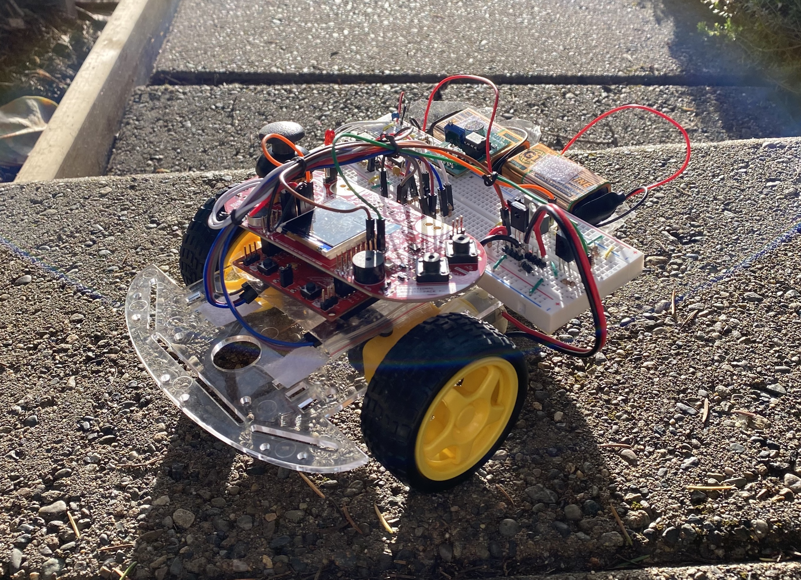
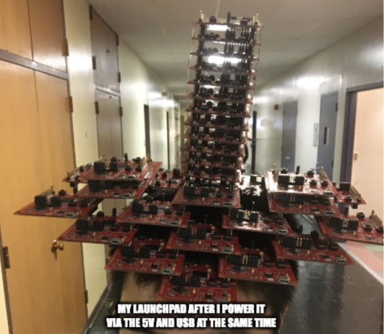

The core of EECS 16B is its lab component, in which students build a voice-controlled robot car built around a microcontroller. While being one of the significant points of frustration with the class, students commonly consider completing the project to be the most central and satisfying component of the class.

  

    Completed EECS 16B Car, Spring 2021

Previously, the class's microcontroller of choice was the TI Launchpad. To be honest, I'm not entirely sure why we used it – ~~probably didn't have anything to do with the couple million dollars TI donated to the school every year.~~

Launchpads lacked documentation and were a buggy mess – while we could generally hide many of these issues from students, they were a huge pain for staff to develop labs with. More notably, Launchpads fried at an incredibly common rate, making for an incredibly frustrating debugging experience when discovering that the root cause was poor hardware.

  

    In Spring 2022 alone, we saw over 200 fried Launchpads. Here, I'm wearing some fried Launchpads as a hat.

In Summer 2022, TI told us that supply chain issues would prevent them from supplying Launchpads for the upcoming fall semester. I saw an opportunity to migrate the course to Arduino, with better documentation, better reliability, and more potential for use outside the classroom.

Together with my co-head Lab TA Shrey Aeron, we fully rewrote lab content and software to function with Arduinos. We submitted a [proposal to the department regarding the design, development, QA/testing, and release to students](/assets/pdf/Arduino%20Development%20Timeline.pdf) for the upcoming semester.

We successfully rolled out the migration during Fall 2022. The Arduinos improved the student experience and lowered costs by reducing board failures. The improved hardware additionally allowed us to make several other lab content changes and quality of life improvements to the overall lab experience.

*The course was still using Arduino in Spring 2024.*